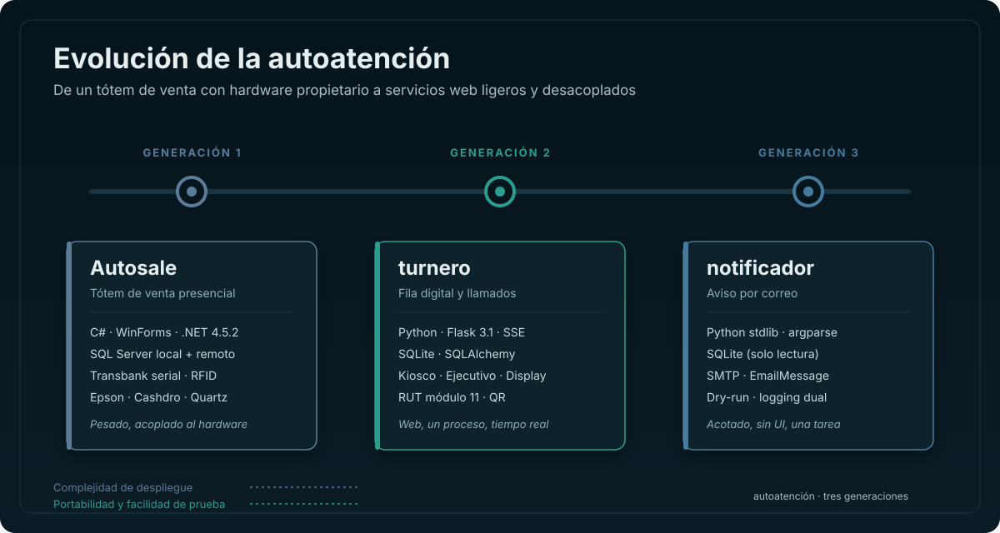
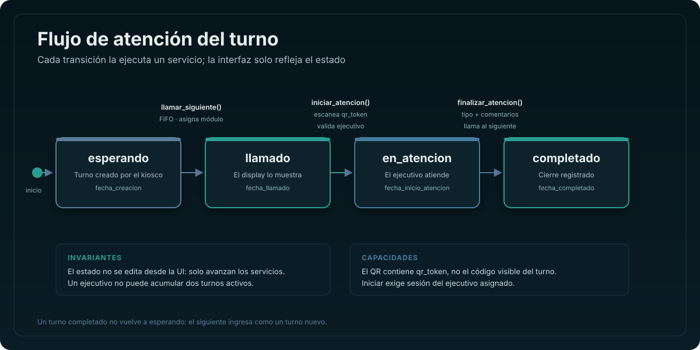
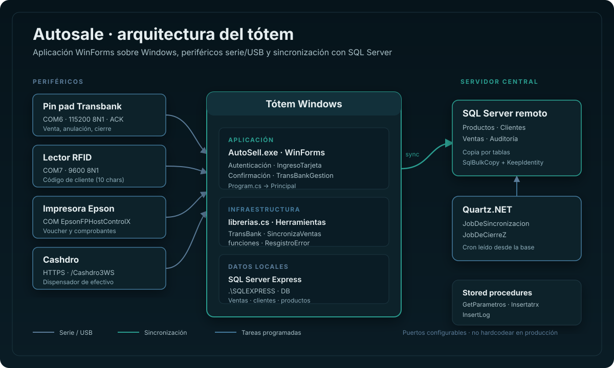
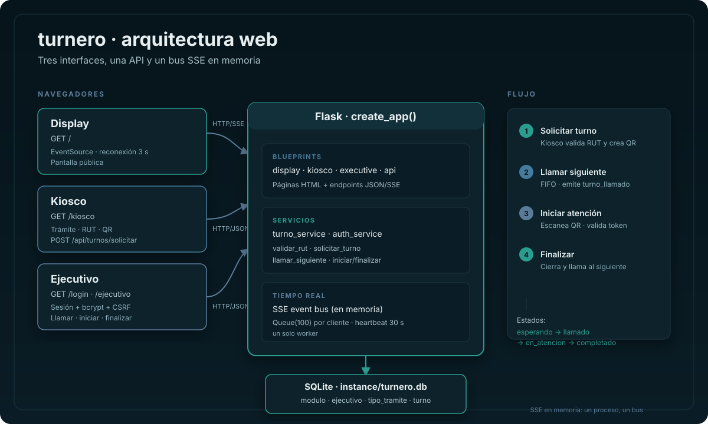

# Autoatención · tres generaciones de un sistema de atención y venta

> **De un tótem de venta con Transbank a una plataforma de turnos con QR, SSE y notificación por correo.**
> Repositorio de estudio que reúne, con fines de portafolio, tres implementaciones sucesivas de software para autoatención: **Autosale**, **turnero** y **notificador**.

<p align="center">
  
</p>

<p align="center">
  
  
  
  
  
</p>

---

## Índice

1. [Qué contiene este repositorio](#qué-contiene-este-repositorio)
2. [La idea en una página](#la-idea-en-una-página)
3. [Evolución del sistema](#evolución-del-sistema)
4. [Mapa de versiones](#mapa-de-versiones)
5. [Flujo de atención de punta a punta](#flujo-de-atención-de-punta-a-punta)
6. [Arquitectura de Autosale (primera versión)](#arquitectura-de-autosale-primera-versión)
7. [Arquitectura de turnero (segunda versión)](#arquitectura-de-turnero-segunda-versión)
8. [Arquitectura de notificador (tercera versión)](#arquitectura-de-notificador-tercera-versión)
9. [Cómo se relacionan las tres versiones](#cómo-se-relacionan-las-tres-versiones)
10. [Requisitos e instalación](#requisitos-e-instalación)
11. [Operación](#operación)
12. [Configuración y variables](#configuración-y-variables)
13. [Despliegue típico](#despliegue-típico)
14. [Seguridad, límites y advertencias](#seguridad-límites-y-advertencias)
15. [Roadmap y mejoras sugeridas](#roadmap-y-mejoras-sugeridas)
16. [Preguntas frecuentes](#preguntas-frecuentes)
17. [Documentación adicional](#documentación-adicional)
18. [Licencia](#licencia)

---

## Qué contiene este repositorio

Este repositorio no es un único producto ejecutable, sino un **archivo de evolución técnica**. Bajo `versions/` conviven tres proyectos independientes que resolvieron, en distintos momentos y con distintas tecnologías, problemas de autoatención:

| Carpeta | Generación | Rol | Stack principal |
|---|---|---|---|
| [`versions/Autosale`](versions/Autosale) | Primera | Tótem de venta con cobro presencial | C# WinForms · .NET Framework 4.5.2 · SQL Server · Transbank serial · RFID · Epson |
| [`versions/turnero`](https://github.com/jmadasme/autoatencion/issues/new?template=solicitud-acceso.yml&title=Solicitud%20de%20acceso%20a%20versiones%20privadas) | Segunda | Gestión de turnos con kiosco, ejecutivo y display | Python 3 · Flask 3.1 · SQLAlchemy · SQLite · SSE · QR |
| [`versions/notificador`](https://github.com/jmadasme/autoatencion/issues/new?template=solicitud-acceso.yml&title=Solicitud%20de%20acceso%20a%20versiones%20privadas) | Tercera | Notificación de un carrito por correo | Python 3.10+ · biblioteca estándar · SQLite · SMTP |

Cada carpeta conserva el contenido original importado desde su repositorio de origen y su propio `VERSION.md`, que explica qué se incluyó, qué se excluyó por privacidad y cómo se sanitizaron los datos. Las credenciales reales, las bases de producción y los artefactos sensibles **no forman parte de este repositorio**.

> **Nota de lectura:** este README y `docs/` describen el conjunto. Cada versión mantiene su documentación original en `versions/<nombre>/README.md` y, cuando existe, en `versions/<nombre>/docs/`. Ante discrepancias, el código y el `VERSION.md` de la versión concreta son la fuente de verdad.

### Qué se puede hacer

- **Estudiar** la evolución: de una aplicación de escritorio monolítica con hardware propietario a una arquitectura web ligera y desacoplada.
- **Con acceso a `turnero`**, ejecutarlo en local y probar el flujo completo con sus tres interfaces.
- **Con acceso a `notificador`**, ejecutarlo contra una SQLite de ejemplo y ver el correo en modo `--dry-run`.
- **Leer `Autosale`** como documento de ingeniería: protocolo serial de Transbank, sincronización con SQL Server y periféricos. Varios formularios están en formato opaco y **no compilan tal cual**.

### Qué no se puede hacer

- No hay una aplicación unificada que arranque las tres versiones a la vez.
- No hay ejecutables, instaladores, bases de datos ni claves.
- No hay integración productiva con Transbank, Cashdro, Epson ni un SMTP real.
- No es un sistema listo para producción sin endurecimiento y revisión legal.

## La idea en una página

La autoatención consiste en trasladar al usuario final parte del trabajo que antes hacía un mostrador: sacar un turno, consultar el estado de una fila, pagar un producto, recibir un comprobante. El software debe resolver tres tensiones clásicas:

1. **Simplicidad para el usuario**: pocos pasos, instrucciones claras, tolerancia a errores de tipeo.
2. **Coherencia operativa**: varias pantallas y varios operadores ven el mismo estado sin pisarse.
3. **Integración con hardware y servicios externos**: impresoras, lectores, pin pads, bases de datos, correo.

Las tres versiones atacan el mismo problema desde ángulos distintos:

- **Autosale** automatiza la **venta presencial** en un tótem: identifica al cliente, consulta su saldo, cobra con Transbank, imprime y sincroniza la venta con un servidor central.
- **turnero** automatiza la **fila de atención**: el cliente pide un turno, un ejecutivo lo llama, lo atiende y lo cierra; una pantalla pública muestra el estado en tiempo real.
- **notificador** automatiza la **comunicación posterior**: detecta el último carrito guardado en SQLite y lo envía por correo.

La evolución tecnológica es deliberada: se pasó de un cliente pesado Windows con dependencias COM y SQL Server a servicios web pequeños, con una base embebida y comunicación por HTTP/SSE. Esa transición reduce el costo de instalación, facilita las pruebas y permite reutilizar componentes.

---

## Evolución del sistema

### Primera generación: Autosale (tótem de venta)

Autosale nace como una aplicación de escritorio para **tótems de autoatención en faenas mineras y casinos en Chile**. El contexto imponía requisitos duros: operación en Windows con hardware serie/USB, cobro con tarjetas mediante un pin pad Transbank, identificación por tarjeta RFID de convenio, impresión de comprobantes en una Epson, sincronización periódica con SQL Server (el tótem podía quedarse sin red) y tolerancia a fallos para no perder ventas.

La solución fue una aplicación **WinForms** con dos proyectos: `AutoSell` y `Biblioteca`. La infraestructura vive en `librerias.cs` (namespace `Herramientas`): acceso a datos, sincronización, tareas Quartz.NET y el cliente serial de Transbank. La UI se reparte en formularios de autenticación, ingreso de tarjeta, confirmación, comandos del POS y mensajes de pantalla. El diseño refleja la época: acoplamiento fuerte entre UI y lógica, conexión directa a SQL Server, credenciales embebidas y formularios del diseñador de Visual Studio. Es una pieza valiosa para entender **cómo se integraba hardware real** antes de las APIs HTTP.

### Segunda generación: turnero (fila digital)

El turnero cambia de problema y de stack. Ya no se cobra: se **ordena la atención** en tres experiencias:

- **Kiosco** (`/kiosco`): el cliente elige el trámite, ingresa su RUT y recibe un ticket con código y QR.
- **Ejecutivo** (`/ejecutivo`): inicia sesión, llama al siguiente, escanea el QR y finaliza la atención.
- **Display** (`/`): pantalla pública con los turnos llamados por módulo, en tiempo real.

La arquitectura es Flask con blueprints, SQLAlchemy y SQLite. El estado tiene cuatro valores (`esperando`, `llamado`, `en_atencion`, `completado`) y transiciones controladas por servicios. La comunicación en vivo usa **Server-Sent Events (SSE)**: el servidor empuja eventos y el navegador reconecta si se corta. No hay WebSocket ni colas externas; para una oficina pequeña alcanza y simplifica.

El turnero introduce mejoras concretas: validación de RUT con módulo 11 en cliente y servidor, contraseñas con bcrypt, sesiones firmadas, protecciones CSRF, token QR aleatorio separado del código visible, interfaz responsive con Bootstrap y base embebida sin motor que instalar.

### Tercera generación: notificador (correo desacoplado)

El notificador es una utilidad de línea de comandos, sin framework y sin dependencias externas. Su tarea es angosta: **leer el último carrito de una base SQLite y enviarlo por correo**. Descubre tablas `carrito_AAAAMMDD_HHMMSS`, elige la más reciente por timestamp, calcula subtotales faltantes, omite filas inválidas con advertencia, genera un correo de texto plano alineado, soporta `--dry-run` y registra en consola y archivo. Usa solo `sqlite3`, `smtplib`, `email`, `logging` y `argparse`.

Es la generación más pequeña, pero la que mejor muestra una filosofía: **una responsabilidad, un ejecutable, una configuración mínima**. También es la que deja más trabajo pendiente para producción (TLS, autenticación SMTP, reintentos, destinatarios múltiples), documentado explícitamente.

### Lectura de la evolución

| Dimensión | Autosale | turnero | notificador |
|---|---|---|---|
| Modelo de ejecución | Cliente Windows pesado | Servidor web + navegador | Script de línea de comandos |
| Estado | SQL Server central + copia local | SQLite embebida | SQLite de solo lectura |
| Interfaz | WinForms | HTML/CSS/JS con Bootstrap | Ninguna (correo) |
| Tiempo real | Sondeo y eventos locales | SSE | No aplica |
| Integración dura | Serial Transbank, RFID, Epson | HTTP/JSON, cámara QR | SMTP |
| Autenticación | Formulario local + RFID | Sesión + bcrypt + CSRF | Ninguna (operador del sistema) |
| Despliegue | Instalador Windows por tótem | Un proceso Python | Cron / Programador de tareas |
| Complejidad | Alta | Media | Baja |


## Modelo de acceso

La **primera versión** (`Autosale`) es pública y gratuita: es el punto de partida para entender el proyecto, probarlo y construir sobre él. Las **2 versiones restantes** son privadas y se comparten solo mediante solicitud.
> **Alcance del repositorio público:** solo está incluida `versions/Autosale`. Las rutas a otras versiones se mencionan como referencia histórica y no forman parte de este repositorio; se comparten por solicitud.


> **Última versión: privada.** Las mejoras, optimizaciones, depuraciones y variantes de hardware no se entregan de forma anónima: se solicitan y se acuerdan con un alcance claro.

**[Solicitar acceso / licencia](https://github.com/jmadasme/autoatencion/issues/new?template=solicitud-acceso.yml&title=Solicitud%20de%20acceso%20a%20versiones%20privadas)**

| Versión | Acceso | Enlace |
|---|---|---|
| `Autosale` | Pública | [Ver carpeta](versions/Autosale/) |
| `turnero` | Privada | [Solicitar acceso](https://github.com/jmadasme/autoatencion/issues/new?template=solicitud-acceso.yml&title=Solicitud%20de%20acceso%20a%20versiones%20privadas) |
| `notificador` | Privada | [Solicitar acceso](https://github.com/jmadasme/autoatencion/issues/new?template=solicitud-acceso.yml&title=Solicitud%20de%20acceso%20a%20versiones%20privadas) |

La licencia MIT de este repositorio se aplica únicamente a la primera versión pública. Las versiones privadas se rigen por el acuerdo de acceso correspondiente.

## Mapa de versiones

### `versions/Autosale` — primera versión

- **Origen**: importado desde `jmadasme/Autosale`.
- **Tipo**: solución Visual Studio (`AutoSell.sln`, formato VS14).
- **Target**: .NET Framework 4.5.2, aplicación WinExe.
- **Dependencias**: Common.Logging 3.0.0, Common.Logging.Core 3.0.0, Newtonsoft.Json 10.0.1, Quartz 2.3.3, referencia COM `EpsonFPHostControlX` / `AxEpsonFPHostControlX` v1.8.
- **Hardware**: pin pad Transbank por serial, lector RFID por serial, lector de código de barras, impresora Epson, dispensador Cashdro por HTTP.
- **Persistencia**: SQL Server local (`.\SQLEXPRESS`) y base remota; sincronización por tablas con `SqlBulkCopy`.
- **Estado del código**: parcialmente legible. Los formularios principales están en un formato binario/opaco que no es texto C# válido. La lógica de infraestructura sí es legible y documentable.
- **Documentación**: `VERSION.md` y README original.

### `versions/turnero` — segunda versión

- **Origen**: importado desde `jmadasme/turnero`.
- **Tipo**: aplicación web Flask con fábrica de aplicación.
- **Dependencias**: `Flask==3.1.*`, `Flask-SQLAlchemy==3.1.*`, `bcrypt==4.*`.
- **Persistencia**: SQLite (`instance/turnero.db` por defecto).
- **Interfaces**: display público, kiosco, login y panel de ejecutivo.
- **Tiempo real**: SSE con heartbeat cada 30 segundos.
- **Estado del código**: completo y ejecutable; incluye seed de datos demo.
- **Documentación**: `VERSION.md`, `README.md`, `docs/datasheet.md`, `docs/developer.md`.

### `versions/notificador` — tercera versión

- **Origen**: importado desde `jmadasme/notificador`.
- **Tipo**: script Python de línea de comandos.
- **Dependencias**: ninguna externa; Python 3.10+.
- **Persistencia**: SQLite en modo lectura (no crea ni migra tablas).
- **Interfaces**: CLI y correo de texto plano.
- **Estado del código**: completo y ejecutable; el envío real es un esqueleto que requiere completar TLS/autenticación.
- **Documentación**: `VERSION.md`, `README.md`, `docs/datasheet.md`, `docs/developer.md`.

### Criterios de sanitización aplicados

Los `VERSION.md` dejan constancia de que, al importar cada proyecto:

- Se excluyeron credenciales, cadenas de conexión reales, bases de datos y archivos de entorno.
- Se conservó la estructura y el código original no sensible.
- Se mantuvieron archivos `.example` cuando el proyecto los preveía.
- Se excluyeron artefactos de compilación y binarios.
- **Excepción documentada**: en Autosale persisten credenciales legacy embebidas en código y un certificado temporal de firma. Se conservan como parte del material histórico, pero **no deben reutilizarse ni publicarse**. La sección de seguridad lo detalla.

---

## Flujo de atención de punta a punta

El recorrido combina turnero y notificador y muestra dónde encajaría Autosale. No es un flujo único implementado de extremo a extremo: es el **modelo mental** que el repositorio permite reconstruir.

### 1. Solicitud del turno

El cliente elige un trámite en el kiosco. La pantalla los obtiene con `GET /api/tramites`, lo formatea y valida el RUT con módulo 11 mientras escribe. Al confirmar, envía `POST /api/turnos/solicitar` con `{tipo_tramite_id, rut}` y encabezados CSRF. El backend revalida el RUT, genera un código correlativo por tipo (prefijo + número) y un `qr_token` aleatorio de 32 bytes en hexadecimal, persiste el turno en `esperando` con fecha UTC y devuelve `201`. El ticket muestra código, trámite y QR; **el QR contiene el token, no el código visible**.

### 2. Llamado

El ejecutivo inicia sesión en `/login`; la sesión guarda `ejecutivo_id`, `ejecutivo_nombre` y `modulo_id`. Al presionar "Llamar siguiente", el frontend consulta `GET /api/ejecutivo/siguiente`. El servicio verifica que el ejecutivo no tenga ya un turno en `llamado` o `en_atencion`, toma el `esperando` más antiguo (FIFO por `fecha_creacion`), lo asigna al ejecutivo y a su módulo, cambia a `llamado`, registra `fecha_llamado` y emite por SSE `turno_llamado` con código, módulo y ejecutivo. El display, suscripto a `/api/turnos/eventos`, actualiza el módulo y resalta el código.

### 3. Atención

El cliente llega al módulo. El ejecutivo escanea el QR con la cámara (`html5-qrcode`) y el frontend envía `POST /api/ejecutivo/iniciar-atencion` con `{qr_token}`. El servicio busca el turno por token, exige estado `llamado` y que el ejecutivo asignado coincida, cambia a `en_atencion`, registra `fecha_inicio_atencion` y emite `turno_atendido`. El display muestra "En atención".

### 4. Cierre

El ejecutivo elige tipo de atención y comentarios opcionales; el frontend envía `POST /api/ejecutivo/finalizar-atencion`. El servicio marca `completado`, guarda `fecha_completado`, tipo y comentarios, emite `turno_finalizado` y acto seguido intenta llamar al siguiente turno del ejecutivo. Si hay, lo pasa a `llamado` y emite un segundo `turno_llamado`. El panel y el display reflejan el nuevo estado.

### 5. Notificación

Un proceso externo (cron, systemd timer o Programador de tareas) ejecuta `notificador.py`. El script abre la SQLite indicada, descubre las tablas `carrito_%`, elige la de timestamp más reciente, lee productos, cantidades, precios y subtotales, calcula lo que falte y arma un correo de texto plano con el detalle y el total. En `--dry-run` registra el contenido y termina con código 0 sin enviar. En modo real intenta SMTP; el código actual **no completa TLS ni autenticación**, un punto de extensión deliberado.

### Diagrama de estados del turno

<p align="center">
  
</p>

El estado avanza solo por acciones del servicio: `esperando → llamado → en_atencion → completado`. Transiciones inválidas (iniciar sin haber sido llamado, finalizar un turno ajeno) se rechazan. La UI no edita el estado.

---

## Arquitectura de Autosale (primera versión)

<p align="center">
  
</p>

### Capas y proyectos

La solución `AutoSell.sln` tiene dos proyectos: `AutoSell` (WinExe, formularios) y `Biblioteca` (ClassLibrary). La aplicación arranca en `Program.Main` con `Application.Run(new Principal())`. El formulario principal coordina autenticación, identificación del cliente, consulta de saldo, confirmación, cobro, impresión y sincronización.

La infraestructura vive en `librerias.cs` (namespace `Herramientas`): acceso a SQL Server, sincronización por tablas, tareas Quartz.NET y el cliente serial de Transbank. En `AutoSell` están los formularios: `Autenticacion`, `IngresoTarjeta`, `Confirmacion`, `TransBankGestion`, `mensajesPantalla` y `Principal`. En `Biblioteca`, `Class1.cs` repite la sincronización y una copia de la clase `TransBank`.

### Integración con Transbank

La clase `TransBank` implementa `IDisposable` y habla por serial con el pin pad:

| Parámetro | Valor |
|---|---|
| Puerto | `COM6` (configurable) |
| Velocidad | 115200 baudios |
| Formato | 8N1, `Handshake.None` |
| Timeout de lectura | 120000 ms |
| Evento | `OnMensajeEstado` con `MensajesTbk` |

El protocolo usa `STX` (0x02) y `ETX` (0x03), campos separados por `|` y checksum XOR sobre todos los caracteres, incluido `ETX`. Al recibir datos, el cliente responde `ACK` (0x06). Comandos: `0070` inicialización, `0080` respuesta de inicialización, `0100` polling, `0200` venta, `0250` última venta, `0410` PAN encriptado, `0500` cierre, `0800` carga de llaves y `1200` anulación.

La venta se envía como `200|precio|timestamp|1|0`. La respuesta se parsea por posiciones fijas: comando, resultado, comercio, terminal, boleta, autorización, monto, últimos dígitos, operación y tipo (`DB` débito, `CR` crédito). Según el tipo se leen fecha, hora, cuenta y abreviaturas en offsets distintos; el voucher llega tras el último separador. Los códigos de resultado se traducen a mensajes de pantalla (autorizador sin respuesta, conexión fallida, anulada, tarjeta no soportada, cancelación, monto mínimo, cierre pendiente, error de lectura). La tabla completa está en [`docs/datasheet.md`](docs/datasheet.md).

Cada transacción se registra con el stored procedure `Insertatrx` (doce parámetros). Si el POS no responde, el flujo se bloquea y se apoya en los mensajes de estado.

### RFID, confirmación y periféricos

`IngresoTarjeta` abre `COM7` a 9600 baudios, 8N1, timeout de 500 ms; en `DataReceived` toma `RxString.Substring(1, 10)` como código de cliente. El formulario es circular y se autocierra a los 10 segundos. La tarjeta no almacena saldo: identifica al socio y el saldo se consulta en la base.

`Confirmacion` recibe producto, cliente, saldo, precio y saldo resultante; usa cultura `es-CL` y formato `{0:C2}`. Los botones Aceptar y Cancelar devuelven el control al flujo.

Otros periféricos: impresora Epson por COM `EpsonFPHostControlX` v1.8, lector de código de barras con puerto configurable, dispensador Cashdro por HTTP (`https://{IP}/Cashdro3WS`) y correo SMTP con adjuntos. `hayconexionInternet()` y `hayconexionCasdro()` permiten degradar el flujo sin red.

### Sincronización y tareas programadas

`SincronizaVentas` lee parámetros con el stored procedure `GetParametros` y copia tablas entre base local y remota con `SqlBulkCopy`; las acciones son `TruncateDestino` y `TruncaOrigen`, con `KeepIdentity` para conservar claves. Los errores se registran con `ResgistroError.insertarLog` (stored procedure `InsertLog`).

Quartz.NET programa `JobDeSincronizacion` (productos y clientes remotos → local; auditoría de clientes local → remota) y `JobDeCierreZ` (cierre de caja). El cron se lee de la base, lo que permite ajustar la frecuencia sin recompilar: una decisión pragmática para flotas de tótems.

### Deuda técnica visible

Duplicación de `TransBank` en dos proyectos, UI y negocio entrelazados, credenciales SMTP embebidas (rotar y externalizar), conexión SQL Server con autenticación integrada de Windows, formularios principales en formato opaco y un certificado temporal de firma incluido en el repositorio.

---

## Arquitectura de turnero (segunda versión)

<p align="center">
  
</p>

### Vista de componentes

```text
Navegador (display) ──┐
Navegador (kiosco)  ──┼── HTTP/JSON + SSE ──► Flask (app.py)
Navegador (ejecutivo)─┘                         │
                                               ├── routes/display.py
                                               ├── routes/kiosco.py
                                               ├── routes/executive.py
                                               ├── routes/api.py
                                               ├── services/turno_service.py
                                               ├── services/auth_service.py
                                               └── models.py ──► SQLite
```

La aplicación usa el patrón **application factory**: `create_app()` construye la app, carga la configuración, inicializa SQLAlchemy, registra blueprints y crea la base si no existe. Al primer arranque, si no hay ejecutivos, ejecuta el seed.

### Blueprints y responsabilidades

| Blueprint | Rutas | Responsabilidad |
|---|---|---|
| `display` | `GET /` | Pantalla pública |
| `kiosco` | `GET /kiosco` | Interfaz de solicitud de turno |
| `executive` | `GET /login`, `GET /ejecutivo` | Login y panel del operador |
| `api` | `/api/...` | JSON, SSE y mutaciones |

### Modelo de datos

```text
Modulo 1 ──── N Ejecutivo
   │
   └──── N Turno ──── 1 TipoTramite
```

- **Modulo**: nombre, activo. Agrupa ejecutivos y turnos.
- **Ejecutivo**: username único, hash bcrypt, nombre, módulo, activo.
- **TipoTramite**: código de una letra, nombre, prefijo del correlativo.
- **Turno**: código único, tipo, RUT, estado, módulo y ejecutivo asignados, marcas de tiempo, tipo de atención, comentarios y `qr_token` único.

`Turno.to_dict()` expone todos los campos para uso interno. `to_display_dict()` elimina `qr_token` antes de enviar datos a endpoints públicos, para que el token no se filtre en la pantalla ni en la API de display.

### Servicios

`turno_service.py` concentra las reglas:

- `validar_rut`: limpia formato, calcula módulo 11 y normaliza 10 → `K`, 11 → `0`.
- `_generar_codigo_turno`: prefijo + cantidad histórica del tipo + 1.
- `solicitar_turno`: valida, crea token y persiste en `esperando`.
- `llamar_siguiente`: impide doble llamado y respeta FIFO.
- `iniciar_atencion`: exige token, estado `llamado` y ejecutivo correcto.
- `finalizar_atencion`: cierra y encadena el siguiente llamado.
- `get_cola`, `get_estado_display`, `get_ejecutivo_estado`: consultas de lectura.

`auth_service.py` maneja bcrypt, sesión, decoradores `login_required`, `api_login_required` y `csrf_protected`. La protección CSRF es artesanal: exige JSON, encabezado `X-Requested-With: XMLHttpRequest` y origen/referer del mismo host. No reemplaza a un token CSRF formal, pero eleva la barrera para peticiones cross-site simples.

### API y SSE

La API se documenta en detalle en [`docs/developer.md`](docs/developer.md). Los grupos son:

- Autenticación: `POST /api/auth/login`, `POST /api/auth/logout`.
- Público: `GET /api/tramites`, `GET /api/modulos`, `GET /api/turnos/display`, `GET /api/turnos/eventos`.
- Kiosco: `POST /api/turnos/solicitar`.
- Ejecutivo: `GET /api/ejecutivo/siguiente`, `POST /api/ejecutivo/iniciar-atencion`, `POST /api/ejecutivo/finalizar-atencion`, `GET /api/ejecutivo/cola`, `GET /api/ejecutivo/estado`.

SSE se implementa con una lista de colas en memoria protegida por un lock. Cada cliente recibe una `Queue(maxsize=100)`; si se llena, se descarta. El endpoint mantiene la conexión abierta, envía un heartbeat cada 30 segundos y consulta la cola cada 5 segundos. Es una solución correcta para **un solo proceso**; con varios workers, los eventos no se comparten y haría falta un bus (Redis, PostgreSQL LISTEN/NOTIFY, etc.).

### Estado y concurrencia

El turno avanza solo por acciones del servicio. `llamar_siguiente` evita que un ejecutivo acumule turnos. La consulta FIFO usa `fecha_creacion` ascendente; si dos solicitudes llegan en el mismo instante, el orden queda determinado por la granularidad del timestamp y el id autogenerado. La generación de códigos por conteo tiene una condición de carrera teórica bajo cargas altas; para una oficina pequeña es aceptable, para varias sucursales conviene una secuencia por tipo y sucursal.

### Frontend

- **Bootstrap 5.3.3** por CDN para layout y componentes.
- **qrcodejs 1.0.0** por CDN en el kiosco; QR de 200×200, color oscuro azul, corrección de errores alta.
- **html5-qrcode 2.3.8** por CDN en el panel del ejecutivo; cámara trasera, 10 fps, recuadro de 250 px.
- **display.js**: carga inicial por fetch, luego `EventSource`; reconexión a los 3 segundos; overlay cuando no hay turnos.
- **kiosco.js**: tres pasos, formateo y validación de RUT, fallback de trámites si la API falla.
- **executive.js**: vistas sin turno, llamado y atención; cronómetro; refresco de cola cada 15 s y de estado cada 10 s; escaneo QR y logout.

### Datos demo

El seed crea tres tipos de trámite (A, B, C), tres módulos y tres ejecutivos de demostración. Las credenciales están en `seed.py` y son **solo para desarrollo**; deben rotarse o eliminarse antes de cualquier despliegue real. Al borrar `instance/turnero.db`, el siguiente arranque vuelve a sembrar los datos.

---

## Arquitectura de notificador (tercera versión)

### Flujo de ejecución

```text
CLI ──► argparse ──► verificar DB ──► sqlite3.connect
                                         │
                                         ├── descubrir tablas carrito_*
                                         ├── elegir la más reciente
                                         ├── leer filas y calcular totales
                                         ├── formatear EmailMessage
                                         └── enviar (o dry-run)
```

### Decisiones de diseño

- **Sin dependencias**: solo biblioteca estándar. Simplifica el despliegue en servidores antiguos; el repositorio igual documenta un entorno virtual por uniformidad.
- **Solo lectura**: no crea tablas, no migra y no escribe en la base. Si no existe, falla con código 1.
- **Descubrimiento por convención**: las tablas se llaman `carrito_AAAAMMDD_HHMMSS` y se ordenan por el timestamp del nombre, no por fecha de creación.
- **Tolerancia a datos sucios**: si `cantidad` o `precio_unitario` son nulos, la fila se omite con warning; si `subtotal` falta o es cero, se calcula.
- **Dry-run de primera clase**: permite validar conexión, selección de tabla y formato sin credenciales SMTP.
- **Logging dual**: consola en INFO, archivo en DEBUG, con protección contra handlers duplicados.

### Formato y envío del correo

Remitente `notificador@kiosco.local`, asunto `Notificación de carrito - {tabla}` y cuerpo de texto plano con tabla alineada (producto, cantidad, precio unitario, subtotal) y línea de TOTAL. Sin adjuntos ni HTML: menos superficie de error y mejor compatibilidad.

El código usa `smtplib.SMTP(host, 587, timeout=30)` y `send_message`, pero **no llama a `starttls()` ni a `login()`**. Es un esqueleto para un relay local o para completar según el proveedor. En producción hay que usar `SMTP_SSL` o `starttls()` con validación de certificado, autenticar con credenciales fuera del código, implementar reintentos con backoff, permitir varios destinatarios y validar direcciones.

### CLI y códigos de salida

```bash
python notificador.py --dry-run
python notificador.py --db-path /ruta/a/kiosco.db --destino admin@ejemplo.cl
python notificador.py --help
```

El `--db-path` relativo se resuelve respecto del directorio del script, no del directorio de trabajo, para evitar sorpresas al ejecutarlo desde cron. Código 0: éxito (incluye dry-run); código 1: base inexistente, error de lectura o fallo de envío.

---

## Cómo se relacionan las tres versiones

No comparten esquema de base ni contrato de API. La relación es **conceptual y de evolución**:

- **Autosale** demuestra la autoatención transaccional con hardware.
- **turnero** demuestra la autoatención de servicios y la coordinación en tiempo real.
- **notificador** demuestra la automatización de una comunicación posterior, desacoplada del frontend.

El notificador, tal como está, apunta por defecto a una base de un proyecto de kiosco con tablas `carrito_*`, no a la base del turnero. Ese acoplamiento por ruta es histórico y **no debe asumirse** como integración lista. Para notificar turnos hay que escribir un adaptador que lea la tabla `turno` y genere el correo; el resto de la utilidad (logging, dry-run, formato) se reutiliza. Autosale tampoco comparte código: su valor es documental, muestra el protocolo serial, la sincronización y el modelo de hardware que las generaciones siguientes evitaron.

---

## Requisitos e instalación

### Requisitos generales

- **Autosale**: Windows 7/8/10, Visual Studio 2015 o superior con .NET Framework 4.5.2, SQL Server Express y hardware compatible (pin pad, RFID, impresora).
- **turnero**: Python 3.10+, pip y navegador moderno. No requiere servidor de base de datos.
- **notificador**: Python 3.10+. No requiere dependencias externas.

### Instalación de turnero

```bash
cd versions/turnero

python3 -m venv venv
source venv/bin/activate        # Linux/Mac
venv\Scripts\activate           # Windows

pip install -r requirements.txt
```

| Paquete | Versión | Uso |
|---|---|---|
| Flask | 3.1.* | Servidor web, rutas, sesiones |
| Flask-SQLAlchemy | 3.1.* | ORM y manejo de SQLite |
| bcrypt | 4.* | Hash de contraseñas |

Arranque:

```bash
python app.py
```

Salida esperada: `[*] Servidor iniciado en http://127.0.0.1:5000`. La base se crea en `instance/turnero.db`; si no existe, se crean las tablas y se cargan los datos demo.

### Instalación de notificador

```bash
cd versions/notificador

python3 -m venv venv
source venv/bin/activate        # Linux/Mac
venv\Scripts\activate           # Windows

pip install -r requirements.txt
```

El `requirements.txt` solo contiene comentarios que documentan que no hay dependencias externas. Aun así, se recomienda el entorno virtual para aislar el intérprete y futuras dependencias.

```bash
python notificador.py --help
python notificador.py --dry-run --db-path ./datos/kiosco.db
```

### Compilación de Autosale

1. Abrir `versions/Autosale/AutoSell.sln` con Visual Studio.
2. Restaurar los paquetes NuGet (Common.Logging, Newtonsoft.Json, Quartz).
3. Verificar la referencia COM a `EpsonFPHostControlX`; si no está registrada, instalarla o quitar la dependencia para compilar.
4. Ajustar cadena de conexión y puertos en `librerias.cs` e `IngresoTarjeta.cs`.
5. Compilar en Debug o Release.

> **Advertencia:** varios formularios están en formato opaco (no son C# de texto). El proyecto **no compila tal cual** en un entorno limpio. La documentación de Autosale es válida como análisis de arquitectura y protocolo, no como receta de build reproducible.

---

## Operación

### Operación de turnero

1. Iniciar el servidor en el equipo central.
2. Abrir el display en la pantalla pública: `http://<host>:5000/`.
3. Abrir el kiosco en el tótem o tablet: `http://<host>:5000/kiosco`.
4. Abrir el panel del ejecutivo: `http://<host>:5000/ejecutivo`; redirige a `/login`.
5. Solicitar un turno y verificar que aparece en el display.
6. Llamar, iniciar y finalizar desde el panel; verificar los cambios.
7. Revisar la cola (se refresca cada 15 s) y cerrar sesión al terminar.

Buenas prácticas: proxy inverso con HTTPS si se expone en red, cambiar `SECRET_KEY` y las credenciales demo, no usar `debug=True` en producción, respaldar `instance/turnero.db` antes de actualizar y ejecutar el proceso con un usuario de sistema sin privilegios.

### Operación de notificador

```bash
python notificador.py --dry-run
python notificador.py --destino operaciones@ejemplo.cl
```

Programación con cron:

```cron
*/15 * * * * cd /opt/notificador && ./venv/bin/python notificador.py >> notificador.cron.log 2>&1
```

En systemd, crear un `.service` de tipo `oneshot` con `WorkingDirectory=/opt/notificador` y `ExecStart=/opt/notificador/venv/bin/python notificador.py`, más un `.timer` con `OnBootSec=5min` y `OnUnitActiveSec=15min`. En Windows, usar el Programador de tareas con `venv\Scripts\python.exe notificador.py`.

### Operación de Autosale

Verificar que el pin pad esté en `COM6` y el lector RFID en `COM7` (o ajustar los puertos), iniciar sesión, pasar la tarjeta del cliente, confirmar producto/saldo/precio, cobrar en el pin pad, esperar voucher e impresión y verificar la sincronización central. Los comandos manuales de `TransBankGestion` permiten inicializar, consultar la última venta, anular, cargar llaves y ejecutar el cierre; son herramientas de soporte, no parte del flujo normal.

---

## Configuración y variables

### turnero

| Variable | Valor por defecto | Descripción |
|---|---|---|
| `PORT` | `5000` | Puerto HTTP |
| `SECRET_KEY` | Clave de desarrollo | Firma de sesiones; **cambiar en producción** |
| `DATABASE_URL` | `sqlite:///turnero.db` | URI de SQLAlchemy |

Archivo relevante: `versions/turnero/config.py`.

### notificador

| Opción / constante | Valor por defecto | Descripción |
|---|---|---|
| `--db-path` | Ruta relativa al script | Base SQLite de origen |
| `--destino` | Constante del script | Correo destino |
| `--dry-run` | Desactivado | No envía, solo registra |
| `SMTP_HOST` | `smtp.gmail.com` | Servidor SMTP |
| `SMTP_PORT` | `587` | Puerto SMTP |
| `LOG_FILE` | `notificador.log` | Archivo de log |

### Autosale

| Parámetro | Dónde se define | Descripción |
|---|---|---|
| Puerto del pin pad | `TransBank.PuertoCOM` | Por defecto `COM6` |
| Puerto RFID | `IngresoTarjeta.PuertoCOM` | Por defecto `COM7` |
| Cadena SQL Server | `funciones.cnLocal` | Instancia local |
| Cron de sincronización | Base de datos | Expresión leída por Quartz |
| IP de Cashdro | Parámetro `IPCashDro` | Dispensador de efectivo |
| Correo | Parámetros y `enviarCorreo` | SMTP y destinatarios |

---

## Despliegue típico

### Turnero en una oficina

```text
                 Red local / Wi-Fi
                        │
        ┌───────────────┼───────────────┐
        │               │               │
   [Display]        [Kiosco]       [Ejecutivo]
   navegador        tablet/tótem    notebook
        │               │               │
        └───────────────┴───────────────┘
                        │ HTTP/SSE
                  ┌─────▼─────┐
                  │  Flask    │
                  │  :5000    │
                  └─────┬─────┘
                        │
                  ┌─────▼─────┐
                  │ SQLite    │
                  │ turnero.db│
                  └───────────┘
```

Recomendaciones:

- Un solo proceso de Flask (o workers con un bus de eventos si se escala).
- Proxy inverso (Nginx/Caddy) con TLS y compresión.
- IP fija o DNS interno para el servidor.
- Pantalla del display en modo kiosco del navegador.
- Reloj del servidor sincronizado por NTP (los timestamps son UTC).

### Notificador en un servidor

```text
cron/systemd ──► python notificador.py ──► SQLite (lectura)
                                      └──► SMTP ──► correo
```

- Ejecutar como usuario sin privilegios.
- Montar la base en solo lectura si es posible.
- Rotar `notificador.log` con `logrotate`.
- Monitorear el código de salida y los fallos de envío.

### Autosale en un tótem

```text
[Pin pad Transbank] ── serial ──┐
[Lector RFID] ─────── serial ──┤
[Lector barras] ───── USB ─────┼── PC Windows ── SQL Server local
[Impresora Epson] ─── USB/COM ─┤                     │
[Dispensador Cashdro] ─ HTTP ──┘                     │
                                              sincronización
                                                     │
                                              SQL Server remoto
```

Cada tótem requiere instalación, configuración de puertos, calibración de impresora y prueba de conectividad.

---

## Seguridad, límites y advertencias

### Seguridad

- **Credenciales**: los repositorios originales fueron sanitizados, pero Autosale conserva credenciales SMTP legacy en `librerias.cs` y un certificado temporal `AutoSell_TemporaryKey.pfx`. **No reutilizar, no publicar, rotar de inmediato** si el código se despliega.
- **Secretos de turnero**: `SECRET_KEY` tiene un valor de desarrollo. Si no se define la variable de entorno, las sesiones son predecibles. Cambiarla siempre.
- **Usuarios demo**: el seed crea ejecutivos con contraseñas conocidas. Deshabilitarlos o cambiarlos en producción.
- **CSRF**: la protección es artesanal y depende de encabezados que un atacante podría intentar replicar en un escenario same-site. Para producción, usar tokens CSRF por sesión.
- **SSE**: no tiene autenticación; el display es público por diseño. No enviar datos personales en los eventos.
- **Datos personales**: el RUT es dato personal. La API de display no lo expone, pero la base sí lo almacena. Aplicar minimización, retención y control de acceso.
- **QR**: el `qr_token` es una capacidad. Quien lo posea puede iniciar la atención si además tiene una sesión de ejecutivo válida. No imprimirlo en lugares públicos más allá del ticket.
- **SMTP**: el notificador no usa TLS ni autenticación. No enviar información sensible hasta completarlo.
- **Autosale**: el protocolo serial no cifra datos; el pin pad maneja el secreto. La base local y la remota deben estar en redes confiables.

### Límites funcionales

- **turnero** no maneja múltiples sucursales, prioridades, turnos preferenciales ni reprogramación.
- No hay notificaciones al cliente (SMS, push) ni pantalla de llamado con audio.
- No hay impresión térmica de tickets: el QR se muestra en pantalla.
- No hay informes históricos ni exportación; solo consultas en vivo.
- La cola se agrupa por tipo de trámite, no por módulo.
- El display muestra un turno actual por módulo; no una lista completa.
- **notificador** no se integra con el esquema del turnero; apunta a tablas `carrito_*`.
- No hay reintentos ni cola de mensajes si el SMTP falla.
- **Autosale** no es compilable tal cual por los archivos opacos; además depende de hardware y licencias de terceros.

### Advertencias legales y de marca

- Transbank, Cashdro, Epson, Microsoft, Flask y demás marcas pertenecen a sus titulares. Este repositorio es material de estudio y no está afiliado a ellas.
- La integración con Transbank requiere contratos, certificación y credenciales vigentes. El código histórico no constituye una guía oficial de integración.
- El tratamiento de datos personales (RUT, correo, transacciones) debe cumplir la normativa aplicable en cada país.

---

## Roadmap y mejoras sugeridas

### Corto plazo

- Reemplazar la protección CSRF artesanal por Flask-WTF o tokens por sesión.
- Externalizar toda la configuración sensible a variables de entorno.
- Agregar pruebas automatizadas de servicios y endpoints.
- Completar TLS y autenticación en el notificador.
- Agregar `requirements.txt` con versiones fijas y auditoría de dependencias.
- Documentar el esquema de la base con migraciones (Alembic).

### Mediano plazo

- Añadir autenticación al display o separar un endpoint público mínimo.
- Implementar prioridades y tiempos estimados de espera.
- Añadir impresión térmica de tickets y aviso por audio.
- Soportar múltiples sucursales con un identificador en módulos y turnos.
- Reemplazar SSE en memoria por un bus (Redis) para escalar horizontalmente.
- Crear un adaptador de notificaciones para turnos y para autoservicio.

### Largo plazo

- Reescribir Autosale como servicio .NET moderno con APIs HTTP y abstracción de hardware.
- Unificar turnero y notificador en una plataforma con identidad, auditoría y observabilidad.
- Añadir panel de administración para trámites, módulos y ejecutivos.
- Métricas: tiempo de espera, tiempo de atención, volumen por tipo, tasa de abandono.

---

## Preguntas frecuentes

**¿Puedo ejecutar las tres versiones juntas?**
No como un producto único. Turnero y notificador pueden convivir en el mismo servidor, pero no comparten esquema. Autosale es una aplicación Windows independiente.

**¿Turnero funciona sin internet?**
Sí, en red local. Bootstrap, qrcodejs y html5-qrcode se cargan por CDN; sin internet, la UI pierde estilos y la generación/lectura de QR puede fallar. Para un despliegue aislado, descargar esos recursos y servirlos localmente.

**¿Dónde se guarda la base de turnero?**
En `versions/turnero/instance/turnero.db`, salvo que se defina `DATABASE_URL`.

**¿Cómo agrego un tipo de trámite?**
Insertando un registro en `tipo_tramite` con código, nombre y prefijo, o extendiendo el seed. El kiosco lo mostrará automáticamente.

**¿Cómo agrego un módulo o un ejecutivo?**
Creando el módulo y el ejecutivo con su hash bcrypt. El seed sirve de ejemplo; en producción conviene un comando administrativo.

**¿El QR contiene el código del turno?**
No. Contiene `qr_token`, un valor aleatorio separado del código visible. Así, conocer el código no permite iniciar la atención.

**¿Por qué SSE y no WebSocket?**
Porque el flujo es unidireccional servidor → navegador, SSE reconecta solo y es más simple de operar. Para interacción bidireccional o escalado, WebSocket o un bus de eventos serían mejores.

**¿Por qué SQLite?**
Porque el despliegue objetivo es una oficina pequeña, sin administrador de base de datos. SQLite simplifica instalación y respaldo. Para concurrencia alta o varias sucursales, conviene PostgreSQL.

**¿El notificador envía correos reales?**
Solo si se completa la configuración SMTP (TLS y autenticación). Tal como está, el envío real es un esqueleto.

**¿Puedo usar el código comercialmente?**
Sí, bajo licencia MIT, siempre que se respeten las licencias de terceros y la normativa aplicable. Autosale contiene dependencias y referencias COM cuyas licencias deben verificarse por separado.

**¿Por qué hay archivos que no se pueden abrir?**
Porque fueron guardados en un formato binario/opaco (probablemente por el diseñador de Visual Studio o por una herramienta externa). Se conservan como evidencia histórica, pero no son editables como texto.

---

## Documentación adicional

| Documento | Contenido |
|---|---|
| [`docs/datasheet.md`](docs/datasheet.md) | Especificaciones, operación por pantalla, campos, códigos de error y solución de problemas |
| [`docs/developer.md`](docs/developer.md) | Arquitectura, módulos, modelo de datos, API, guías de extensión y pruebas |
| [`docs/REFERENCES.md`](docs/REFERENCES.md) | Enlaces a documentación oficial y material de consulta |
| [`docs/BITACORA.md`](docs/BITACORA.md) | Decisiones, problemas, enfoques descartados y lecciones aprendidas |
| [`docs/assets/`](docs/assets) | Diagramas SVG del proyecto |
| [`versions/turnero/README.md`](https://github.com/jmadasme/autoatencion/issues/new?template=solicitud-acceso.yml&title=Solicitud%20de%20acceso%20a%20versiones%20privadas) | Documentación original del turnero |
| [`versions/turnero/docs/`](https://github.com/jmadasme/autoatencion/issues/new?template=solicitud-acceso.yml&title=Solicitud%20de%20acceso%20a%20versiones%20privadas) | Datasheet y guía de desarrollador del turnero |
| [`versions/notificador/README.md`](https://github.com/jmadasme/autoatencion/issues/new?template=solicitud-acceso.yml&title=Solicitud%20de%20acceso%20a%20versiones%20privadas) | Documentación original del notificador |
| [`versions/notificador/docs/`](https://github.com/jmadasme/autoatencion/issues/new?template=solicitud-acceso.yml&title=Solicitud%20de%20acceso%20a%20versiones%20privadas) | Datasheet y guía de desarrollador del notificador |
| [`versions/Autosale/VERSION.md`](versions/Autosale/VERSION.md) | Alcance y sanitización de la primera versión |

---

## Licencia

Este repositorio se distribuye bajo **licencia MIT**. El texto completo está en [`LICENSE`](LICENSE).

Copyright (c) 2026 jmadasme. Se permite usar, copiar, modificar, fusionar, publicar, distribuir, sublicenciar y vender el software, siempre que se conserve el aviso de copyright y la licencia. El software se entrega **sin garantías** de ningún tipo.

> **Nota:** la licencia MIT cubre el código y la documentación originales de este repositorio. Las dependencias de terceros (Transbank, Epson, Cashdro, Quartz.NET, Bootstrap, qrcodejs, html5-qrcode, etc.) mantienen sus propias licencias y condiciones.

---

<p align="center">
  <sub>Documentación generada para el portafolio de jmadasme · 2026</sub>
</p>
